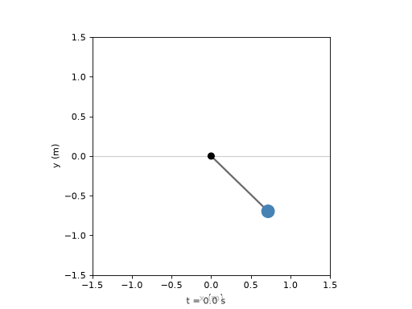

# Trajectory animations

The animation module draws **completed, sampled trajectories** using
Matplotlib. It does not integrate a model or receive control commands.
The `anim` extra or Matplotlib can be installed as described in
[Installation](installation.md).

There are two parts to an animation:

1. A model-specific helper creates the artists and returns a callable
   `update(frame)` for the supplied trajectory.
2. `AutoAnimation` selects frame indices, updates the time label and constructs
   a Matplotlib `FuncAnimation`.

## Animate a pendulum

The following script simulates the motion first and then animates its angle:

```{testcode} pendulum-animation
import numpy as np
import matplotlib.pyplot as plt
from scipy.integrate import solve_ivp
from benchmark_systems.models import pendulum
from benchmark_systems.animations import Pendulum, AutoAnimation

times = np.linspace(0.0, 4.0, 201)
result = solve_ivp(
    lambda t, x: pendulum(t, x, m=1.0, L=1.0, drag=0.1, u=0.0),
    (0.0, 4.0), [0.8, 0.0], t_eval=times,
    rtol=1e-8, atol=1e-10,
)

fig, ax = plt.subplots()
ax.set_xlabel("x (m)")
ax.set_ylabel("y (m)")
update = Pendulum(ax, L=1.0, theta=result.y[0])
animation, frames = AutoAnimation(
    fig, update, times=result.t, fps=25, speed=2, repeat=False,
)
fig.canvas.draw()
print(len(frames), frames[-1])
plt.show()
```

```{testoutput} pendulum-animation
101 200
```

The `solve_ivp` call first computes 201 samples over four seconds. Its
initial state `[0.8, 0.0]` specifies angle and angular velocity; `drag=0.1`
adds damping and `u=0.0` leaves the motion unforced. In
`Pendulum(ax, L=1.0, theta=result.y[0])`, `L` sets the drawn rod length and
`theta` supplies the complete angle trajectory. The returned `update`
callback knows how to draw a selected sample.

`AutoAnimation` connects that callback to `fig`. `times=result.t` supplies
the simulation-time labels, `speed=2` selects every second sample, and
`fps=25` sets playback to 25 frames per second. `repeat=False` stops at the
end. The printed `101 200` means 101 displayed frames, ending at sample
index 200. `fig.canvas.draw()` initializes the figure before display;
`plt.show()` opens it with an interactive backend.



A reference to `animation` must remain alive while it is displayed or exported.
An interactive Matplotlib backend is required for a desktop animation window;
a static notebook backend displays only a still image.

## Timing and array shapes

- `times` contains one finite, strictly increasing time per trajectory sample.
- `speed` is a positive integer frame stride. A value of `2` draws every second
  sample; the final sample is always included.
- `fps` sets the playback rate. If omitted, it is inferred from the median
  sample spacing and capped at 60 frames per second.
- Matplotlib uses a constant frame interval. For nonuniform sample times, the
  labels remain correct but the intervals between frames do not reproduce the
  nonuniform timing automatically.
- Scalar trajectories are one-dimensional arrays. Three-dimensional vector
  trajectories, such as quadrotor position, use shape `(3, n_frames)`.
- Related trajectories supplied to an animator must have matching lengths.

For uniform sampling, playback duration is approximately the number of selected
frame intervals divided by `fps`. Changing `speed` and `fps` changes playback,
not the previously simulated dynamics.

The legacy `duration` and `dt` arguments remain available when `times` is
omitted. Explicit solver output times are preferable because they associate
the displayed labels directly with the data.

## Save or embed the animation

With Pillow installed, we will export the animation created above as a GIF:

```python
animation.save("pendulum.gif", writer="pillow", fps=25)
```

`writer="pillow"` selects the GIF encoder and the filename chooses the
output path. The export's `fps=25` sets the saved playback rate; it does not
change the simulated samples.

With FFmpeg installed and available to Matplotlib:

```python
animation.save("pendulum.mp4", writer="ffmpeg", fps=25)
```

`writer="ffmpeg"` selects the video encoder and the `.mp4` extension
chooses the output format. The same animation and frame selection are
reused for this export.

In a notebook with IPython installed, the animation can be embedded as a JavaScript player:

```python
from IPython.display import HTML

HTML(animation.to_jshtml())
```

`animation.to_jshtml()` generates an HTML player for the selected frames.
Wrapping it in `HTML(...)` lets the notebook render the player with playback
controls instead of displaying the HTML as text.

## Other systems

The [animation API reference](api/animations.md) lists helpers for electrical,
mechanical and process models. A helper's inputs are the state trajectories
it needs for drawing, not necessarily the complete state vector. For example,
`Pendulum` needs the angle, whereas `Quadrotor` takes position and Euler angles.
The [catalog](models.md) identifies the correct state rows and coordinates.
