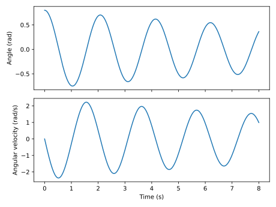

# Simple pendulum example

This example simulates a damped pendulum using SciPy, then plots its angular
position and velocity. The required numerical dependencies and Matplotlib are
listed in [Installation](installation.md).

## Define the model

The state is $x=[\theta,\omega]^T$, with angle in radians and angular velocity
in rad/s. The angle is measured from the downward vertical, so $\theta=0$ is
the hanging equilibrium and $\theta=\pi$ points upward.

For mass $m$, length $L$, drag coefficient $b$ and applied torque $u$:

$$
\dot{\theta}=\omega,\qquad
\dot{\omega}=-\frac{g}{L}\sin\theta
-\frac{b}{mL^2}\omega+\frac{u}{mL^2}.
$$

The numerical function returns the derivative; it does not advance time or
store a trajectory. We will bind its physical parameters and input when calling a
solver:

```{testcode} quickstart
import numpy as np
from scipy.integrate import solve_ivp
from benchmark_systems.models import pendulum

parameters = {"m": 1.0, "L": 1.0, "drag": 0.12}

def rhs(t, x):
    return pendulum(t, x, **parameters, u=0.0)

times = np.linspace(0.0, 8.0, 401)
result = solve_ivp(
    rhs,
    t_span=(0.0, 8.0),
    y0=[0.8, 0.0],
    t_eval=times,
    rtol=1e-8,
    atol=1e-10,
)

print(result.y.shape)
```

```{testoutput} quickstart
(2, 401)
```

The `parameters` dictionary sets a 1 kg mass, a 1 m rod and rotational
viscous damping `drag=0.12`. In `rhs`, `**parameters` passes these values to
`pendulum`, while `u=0.0` leaves the pendulum unforced. This gives SciPy the
`rhs(t, x)` callable it expects.

In `solve_ivp`, `t_span=(0.0, 8.0)` sets the experiment duration and
`y0=[0.8, 0.0]` starts it at 0.8 rad with zero angular velocity.
`np.linspace(0.0, 8.0, 401)` requests output every 0.02 s through `t_eval`;
it does not fix the solver's internal step size. `rtol` and `atol` control
relative and absolute integration error tolerances, respectively.

`result.t` contains the output times. Each column of `result.y` is one state
sample: `result.y[0]` is the angle and `result.y[1]` is angular velocity.

## Plot the result

```{testcode} quickstart
import matplotlib.pyplot as plt

fig, axes = plt.subplots(2, 1, sharex=True, figsize=(6.4, 4.8))
axes[0].plot(result.t, result.y[0])
axes[0].set_ylabel("Angle (rad)")
axes[1].plot(result.t, result.y[1])
axes[1].set_ylabel("Angular velocity (rad/s)")
axes[1].set_xlabel("Time (s)")
fig.tight_layout()
plt.show()
```

`plt.subplots(2, 1, sharex=True)` creates two stacked panels with a shared
time axis; `figsize` sets the figure dimensions in inches. The two `plot`
calls select the angle and angular-velocity rows of `result.y`. The labels
keep their different units explicit, `tight_layout()` adjusts the spacing,
and `plt.show()` displays the figure.



The amplitude decreases because the drag coefficient is positive. Setting
`drag=0.0` removes that dissipation from the equations.

## Continue the experiment

- [Numerical simulation](numerical.md) explains changing inputs and implicit DAEs.
- [Symbolic models](symbolic.md) linearizes a quadrotor and designs an LQR controller.
- [Trajectory animations](animations.md) turns the sampled states into a movie.
- The [model catalog](models.md) lists the other systems and their conventions.
